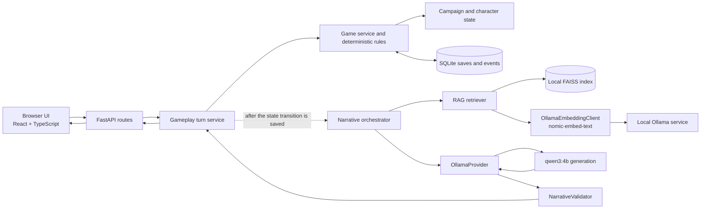

# Macbeth AI Story Game

Macbeth AI Story Game is a local-first branching narrative application. Play as Macbeth, Lady Macbeth, Banquo, or Macduff through authored campaigns whose choices change a deterministic game state. A locally running language model writes character-specific narration for that state.

Interactive language models can improvise, but open-ended generation can also contradict earlier events or reveal information a character should not know. This project keeps story progression, choice authorization, character state, and persistence in application code. The model supplies validated narration; it does not advance the game.

The intended setup is one person using a browser and backend bound to loopback, with Ollama and the models running on the same computer. No cloud API is required by the documented configuration. The original source PDF and its derived RAG files are not distributed.

> **Local use only:** the API has no authentication or per-user save ownership. Public or shared-network exposure is unsupported. Public deployment has not been validated.

## Features

- Four independent campaigns: Macbeth, Lady Macbeth, Banquo, and Macduff.
- 60 authored scenes, 107 choices, and 18 distinct ending IDs across the campaign catalogs.
- Deterministic choice validation, branching, state transitions, and ending selection.
- Character-specific narration generated locally by Ollama using `qwen3:4b`.
- Local retrieval-augmented generation (RAG) over an authorized Macbeth source using `nomic-embed-text` embeddings and FAISS search.
- Character psychology and directional relationships that change through authored choices.
- Per-save memories, secrets, promises, rumours, and explicit character knowledge boundaries.
- SQLite save, resume, event history, and deletion.
- Validated model output: narration cannot authorize a new choice or change saved game state.

Each game ID owns one campaign timeline. Campaign state is not shared between separate game IDs.

## Technology

| Area | Technologies |
| --- | --- |
| Backend | Python 3.11+, FastAPI, Pydantic, SQLite |
| Frontend | React, TypeScript, Vite |
| Local AI | Ollama, Qwen3:4b, nomic-embed-text |
| Retrieval | PDF text extraction, RAG, FAISS, provenance-bearing passages |
| Quality checks | pytest, pytest-cov, Ruff, Vitest, Playwright, TypeScript checks |

## Architecture at a glance



The deterministic engine validates choices and applies the authorized transition before narration begins. The resulting game state and events are saved in SQLite. The narrative orchestrator then assembles character-scoped context, retrieves relevant source passages, and requests prose. Validated narration is returned to the client; it does not write back into the game state.

See [Architecture documentation](docs/architecture/README.md) for system, sequence, campaign-flow, and local-deployment diagrams. The module map and data-flow notes are in [System architecture](docs/architecture/system_architecture.md).

## Requirements

- Python 3.11 or newer for the backend, as declared in `pyproject.toml`.
- Node.js supported by the locked Vite release (Node 18.x, 20.x, or 22+) and npm. CI currently uses Node.js 26 LTS.
- Ollama installed separately for AI narration and embeddings. Install it from the [official Ollama downloads page](https://ollama.com/download).
- The required Ollama models pulled explicitly:
  - `qwen3:4b` for generation.
  - `nomic-embed-text` for retrieval.
- An authorized local copy of the Macbeth source PDF to build the RAG index. The project does not include the PDF or the generated index files.

The RAG extra depends on `faiss-cpu`, whose wheels vary by Python version and platform. If installation reports that no compatible distribution exists, use a Python version supported by that dependency on your platform.

## Setup

Run backend commands from the project root. Choose the virtual-environment commands for your shell.

### Create the Python environment

**Windows PowerShell:**

```powershell
py -3.11 -m venv .venv
.\.venv\Scripts\Activate.ps1
python -m pip install --upgrade pip
python -m pip install -e ".[dev]"
Copy-Item .env.example .env
```

**macOS or Linux:**

```sh
python3 -m venv .venv
source .venv/bin/activate
python -m pip install --upgrade pip
python -m pip install -e ".[dev]"
cp .env.example .env
```

The core install supports the health and deterministic game APIs. For RAG and generated narration, install its optional dependencies from the project root:

```sh
python -m pip install -e ".[dev,rag]"
```

The example configuration uses `http://localhost:11434`, `qwen3:4b`, and `nomic-embed-text`. You can edit `.env` to change local paths or settings. The Vite proxy defaults to `http://127.0.0.1:8000`; optional frontend settings are in [`frontend/.env.example`](frontend/.env.example).

### Install Ollama and models

Install Ollama separately, then pull the configured models:

```sh
ollama pull qwen3:4b
ollama pull nomic-embed-text
ollama list
```

Ollama may already run as a desktop service. If it is not running, start it in a separate terminal with `ollama serve`. The application does not download models or call a cloud model service.

### Provide an authorized RAG source and build the index

The source PDF, extracted chunks, FAISS index, and metadata are intentionally excluded from publication pending verification of the PDF edition and redistribution rights. To use RAG, obtain an authorized source copy locally and either place it at the configured `PDF_SOURCE_PATH` or set that environment variable to its location. Keep the PDF and generated files local.

The application starts without a PDF or index. Until an index is built, `POST /api/v1/rag/search` returns HTTP 503 with a message that the index must be built first. Ingesting a PDF extracts and chunks text without calling Ollama; building the FAISS index then requires the configured local embedding model.

From the project root, install the RAG dependencies, inspect the source, extract chunks, and build the index:

```sh
python -m pip install -e ".[dev,rag]"
python scripts/ingest_corpus.py --inspect-only
python scripts/ingest_corpus.py
python scripts/build_index.py
```

The default generated files are under ignored `data/`: SQLite saves at `data/macbeth.sqlite3`, chunks at `data/macbeth/chunks.json`, and the FAISS index and metadata under `data/faiss/`. The application does not build the index at startup.

### Start the application

In one terminal at the project root, with the Python environment active:

```sh
uvicorn macbeth_game.main:app --host 127.0.0.1 --port 8000
```

In a second terminal, from the project root:

```sh
cd frontend
npm ci
npm run dev -- --host 127.0.0.1
```

Open <http://127.0.0.1:5173>. The API health endpoint is <http://127.0.0.1:8000/api/v1/health>. Keep both services bound to loopback.

## Development and tests

Install the full Python test dependencies, including RAG dependencies, from the project root:

```sh
python -m pip install -e ".[dev,rag]"
python -m pytest --basetemp=.pytest-tmp
python -m ruff check src tests
```

For frontend checks, run from `frontend/`:

```sh
npm ci
npm test
npm run build
```

The build command runs both application and E2E TypeScript checks before Vite builds the frontend. To run mocked Chromium browser tests, install Chromium once with `npx playwright install chromium`, then run `npm run test:e2e`. The real local smoke test is opt-in: `npm run test:e2e:local`; it requires Ollama, both models, and a built local FAISS index.

### Verified quality results

These are separate runs; their counts are not combined.

| Run | Verified results |
| --- | --- |
| Fresh publication snapshot (Python 3.13.1, Node.js 26.13.0) | Installed the backend with `.[dev]` and then `.[dev,rag]`; 159 Python tests passed, including all 15 synthetic RAG tests; Ruff clean. A clean `npm ci` installed the frontend, 29 tests passed, both TypeScript checks passed, and the production build succeeded. FastAPI started with a fresh temporary SQLite database; all four campaign selections worked; a Macbeth choice survived an application restart and could be deleted. Missing-index RAG returned setup guidance, and ingestion of generated synthetic PDF text produced a chunk manifest. A temporary two-vector FAISS index was built with real `nomic-embed-text` embeddings; a real `qwen3:4b` gameplay turn returned narration that passed response validation. No original database, PDF, or FAISS files were present in the snapshot. |
| Phase 7.6 integration run (Python 3.13.1) | 159 Python tests passed; **83% line coverage**; Ruff clean; one upstream AnyIO deprecation warning. Frontend: 29 unit tests passed, TypeScript/build passed, 9 mocked Playwright tests passed, and one local Ollama smoke test passed. The 10-case narrative evaluation produced 10 valid structured responses. See the [Phase 7.6 report](docs/phase_7_6_release_readiness_report.md). |
| Latest cleanup verification (Python 3.15.2) | 144 Python tests passed with `tests/test_rag.py` excluded; partial-run coverage was 69%; Ruff clean. Frontend: 29 tests passed, TypeScript checks and production build passed. A standard package install and `httpx` runtime import passed in a temporary environment. |

The complete RAG test module was not run in the latest cleanup verification: the available Python 3.15.2 environment could not resolve a compatible `faiss-cpu` distribution. The earlier Python test collection also reported that PyMuPDF was unavailable. These are environment limitations, not passing RAG test results.

## Continuous integration

Two GitHub Actions workflows are defined under `.github/workflows/`:

- `backend-ci.yml` runs Ruff and the complete backend test suite, including RAG tests, on Python 3.11, 3.13, and 3.14. Tests use temporary SQLite databases and synthetic PDF/FAISS fixtures. Coverage is printed and written as XML in the runner's temporary directory.
- `frontend-ci.yml` uses Node.js 26 LTS, installs the lockfile with `npm ci`, runs `npm test`, and runs `npm run build` (which includes both TypeScript checks).

Normal CI does not start Ollama or download models. The real-model narrative evaluation and `npm run test:e2e:local` remain opt-in because they require a separately installed local Ollama service, `qwen3:4b`, `nomic-embed-text`, and a locally built FAISS index. These workflows have not run remotely because this directory has no GitHub repository. CI status badges will be added after a repository exists and the workflows have actually run.

## API surface

Routes use the `/api/v1` prefix:

| Route | Purpose |
| --- | --- |
| `GET /health` | Service health |
| `GET /characters` | Playable characters |
| `POST /games` | Start a campaign save |
| `GET /games`, `GET /games/{id}` | List saves or load a save |
| `GET /games/{id}/choices` | Inspect current authorized choices |
| `POST /games/{id}/choices` | Apply a deterministic choice without generated narration |
| `POST /games/{id}/turns` | Apply one choice, persist it, and request narration |
| `POST /games/{id}/narrative` | Retry narration for the persisted current state |
| `GET /games/{id}/events` | Read ordered game events |
| `DELETE /games/{id}` | Delete a local save and its events |
| `POST /rag/search` | Retrieve locally indexed source passages |

## Screenshots

No approved gameplay screenshots are included yet. Screenshots can be added under `docs/assets/` after checking that they contain no personal save data and reviewing their size and licensing. Gameplay recordings are not included.

## Architecture and project notes

The architecture diagrams map to the implementation:

- `src/macbeth_game/api/` — FastAPI routes and request/response schemas.
- `src/macbeth_game/services/game_service.py` — campaign loading, game operations, choice execution, and repository coordination.
- `src/macbeth_game/engine/` — story-content validation, choice conditions, and character simulation.
- `src/macbeth_game/services/gameplay_turn_service.py` — persists a choice before requesting narration.
- `src/macbeth_game/services/narrative_orchestrator.py` — builds character-scoped context, retrieves passages, and coordinates generation and validation.
- `src/macbeth_game/llm/` — local Ollama provider, prompt construction, response schema, and validation.
- `src/macbeth_game/rag/` — PDF extraction, chunking, local embedding client, FAISS storage, and retrieval.
- `src/macbeth_game/repositories/sqlite_repository.py` — authoritative game state and ordered events in SQLite.
- `content/macbeth/*.json` — authored campaign and story content.

For implementation history and evaluation details, see the [story architecture audit](docs/phase_7_1_story_architecture_audit.md), [story expansion](docs/phase_7_2_complete_macbeth_story.md), [four campaigns](docs/phase_7_3_four_character_campaigns.md), [character psychology and memory](docs/phase_7_4_character_psychology_memory.md), [narrative intelligence](docs/phase_7_5_narrative_intelligence.md), and [release-readiness report](docs/phase_7_6_release_readiness_report.md).

## Limitations and security

- The application targets one user on loopback. It does not implement authentication, authorization, or per-user save ownership.
- Public or shared-network exposure is unsupported. The API can read and delete saves and trigger local inference.
- Public deployment has not been validated; this project is not presented as production-ready.
- Ollama and the configured models must be installed and pulled separately. No cloud API is required by the documented setup.
- The source PDF and PDF-derived chunks, FAISS index, and metadata are excluded and must be supplied or generated locally from material the user is authorized to use.
- No project license is included. The PDF’s edition and redistribution rights remain unresolved.

## Possible future work

These items are not implemented:

- Run the configured GitHub Actions workflows after a GitHub repository is available.
- Make RAG onboarding reproducible with a rights-cleared source and documented index provenance.
- Add authentication and per-user save ownership only if multi-user or network deployment becomes a project goal.

## Contributing

Development setup and verification commands are documented above. A formal external contribution process and support policy have not been established; no external contribution workflow is promised at this stage.
