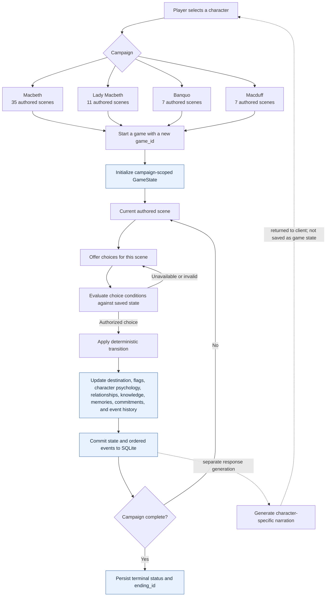

# Campaign and game-state flow

The authored catalogs contain 60 scene definitions, 107 choice definitions, and 18 distinct ending IDs. Macbeth's campaign uses the 35-scene main catalog; Lady Macbeth, Banquo, and Macduff use their own authored campaign scenes. Each started game belongs to exactly one campaign.

Each campaign creates a separate game ID and SQLite record. Campaigns can share the authored world and character definitions, but their saves, event histories, knowledge, relationships, memories, and outcomes are not synchronized across game IDs. Within a save, authored effects can change multiple characters' state.

The persistent state includes the selected campaign, current scene, flags, status and ending, per-character psychology and known facts, directional relationships, memories, promises/secrets, and ordered events. Choice availability and scene progression are determined by authored content and deterministic rules.

Narration is generated from the saved state after a transition. It may vary between requests, but it cannot select a destination, alter a flag, authorize a choice, or replace the saved event history. Retrying narration does not replay the choice.
