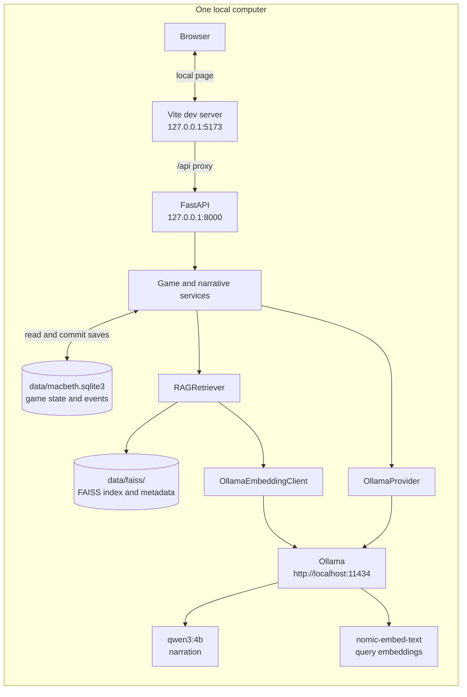

# Local deployment

The documented setup runs the browser, frontend development server, FastAPI application, SQLite file, FAISS files, and Ollama on one user's computer. The development servers bind to loopback. This is a local topology, not a supported public/shared-network deployment.

The backend's default settings use SQLite at `data/macbeth.sqlite3`, the FAISS index under `data/faiss/`, and Ollama at `http://localhost:11434`. `.env` can override these settings. The default Vite proxy forwards `/api` requests to `127.0.0.1:8000`.

The backend does not download models, extract PDFs, build an index, or contact Ollama during startup. Model installation and RAG index creation are explicit local steps. The source PDF and generated chunks/index/metadata are not distributed. No cloud API is required by this local configuration.

The API has no authentication or per-user save ownership. Keep it bound to loopback; public and shared-network exposure is unsupported. See the [README limitations](../../README.md#limitations-and-security).
