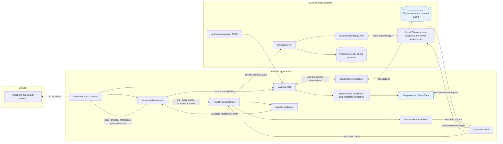

# System architecture

## Component responsibilities

| Component | Implementation | Responsibility |
| --- | --- | --- |
| Frontend | `frontend/src/` | Renders campaign selection and gameplay; sends API requests and displays returned state, choices, narration, and status. |
| API layer | `src/macbeth_game/api/` | Validates HTTP request/response contracts and calls application services. |
| Game service | `src/macbeth_game/services/game_service.py` | Loads authored content, starts games, exposes eligible choices, applies authorized choices, and coordinates repository operations. |
| Deterministic rules | `src/macbeth_game/engine/` | Validates story graphs and choice conditions; applies authored character and relationship changes, knowledge grants, and commitments. |
| Campaign and character state | `src/macbeth_game/domain/models.py` | Models the selected campaign, current scene, flags, per-character state, relationships, memories, commitments, and ordered event history. |
| Turn service | `src/macbeth_game/services/gameplay_turn_service.py` | Applies a choice once and requests narration for the saved state. |
| Narrative orchestration | `src/macbeth_game/services/narrative_orchestrator.py` | Selects character-visible context, checks engine-authorized choices, retrieves passages, builds a bounded prompt, and validates the response. |
| Local model integration | `src/macbeth_game/llm/` | Sends prompt and embedding requests to the configured local Ollama service; builds prompts and validates structured narrative output. |
| Retrieval | `src/macbeth_game/rag/` | Extracts/chunks source text through explicit CLI commands, embeds queries, searches FAISS, and returns passages with source metadata. |
| Persistence | `src/macbeth_game/repositories/sqlite_repository.py` | Stores authoritative game state and ordered events in SQLite with revision checks and transactional updates. |

The authored catalogs in `content/macbeth/*.json` define campaigns, scenes, characters, choices, and effects. The application validates this content on startup. Campaigns use separate game IDs and save state; a decision in one save does not mutate another campaign save.

## System diagram

The `Turn -> Narrative` edge occurs after the deterministic choice has been persisted. There is no edge from the model back to `GameService`: validated narrative is returned to the client and is not authoritative state. If generation fails, the transition remains saved and the narration endpoint can be retried.

At runtime, retrieval reads the existing local FAISS index and metadata. PDF extraction and index construction are separate explicit CLI operations. The source PDF, extracted chunks, index, and metadata are not included in this repository pending verification of source rights.
