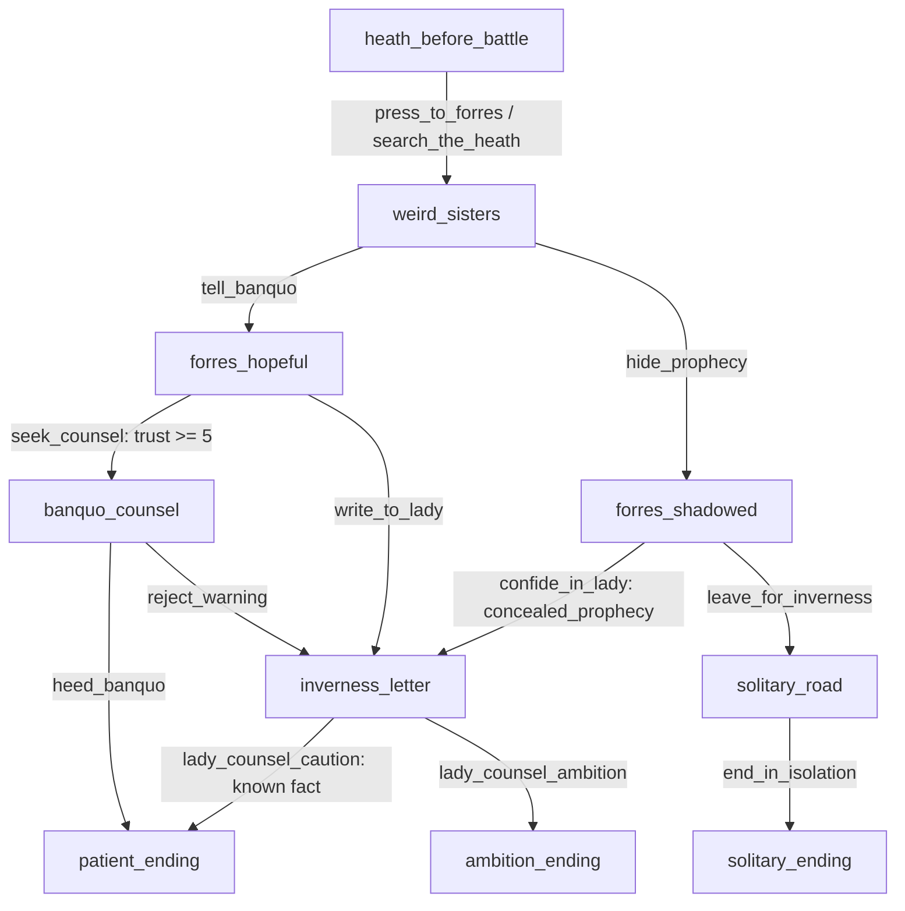

# Phase 7.1 — Macbeth Story Architecture Audit

**Audit scope:** version-controlled Macbeth story content, deterministic story engine, narrative prompt/validation flow, and the checked-in local RAG corpus/index metadata. This is an audit only. No application, content, test, prompt, configuration, database, or index files were changed. Tests and live Ollama/RAG requests were not run.

## 1. Current story architecture

The story is defined in `content/macbeth/characters.json` and `content/macbeth/scenes.json`. `src/macbeth_game/engine/content.py` loads the two JSON files into Pydantic `CharacterDefinition` and `SceneDefinition` models and checks unique IDs, valid choice destinations, and selected references to characters. `src/macbeth_game/domain/models.py` defines state, event, choice-condition, and ending contracts. `GameService` starts each game at `heath_before_battle`, applies deterministic choice consequences, and persists revisions/events through the repository. Choice eligibility is evaluated in `src/macbeth_game/engine/conditions.py`.

Narrative generation is separate from state transitions. `NarrativeOrchestrator` reads the current state and event history, retrieves up to four passages, builds a bounded prompt, calls the LLM, and validates its JSON response. Engine-generated choices remain authoritative; generated choice descriptions are accepted only for their existing IDs. `GameState` has `ambition`, `morality`, `suspicion`, `alive`, and `known_facts` per character, plus relationships, boolean flags, turn/revision, completion status, and ending ID. The current content primarily changes ambition, suspicion, a little trust, facts, and flags.

The content contains **10 scenes, 13 choices, 4 character definitions, and 3 ending scenes**. All authored scenes are in `scenes.json`; there are no separate story/act/scene JSON files. The checked-in source corpus is `content/macbeth/source/macbeth_original.pdf`. The checked-in RAG metadata says it represents 153 chunks from that PDF, embedded with `nomic-embed-text` at 768 dimensions with cosine similarity. Of those chunks, 147 carry both act and scene metadata, 5 carry act only, and 1 carries neither. Metadata has page numbers for all 153 chunks.

## 2. Scene inventory

Canonical references below quote or summarize the scene JSON’s `canonical_reference`. A “route” reference is an authored game mapping, not proof the scene depicts every canonical event in that Shakespeare scene.

| Scene ID | Title / setting | Reference and description | Participants | Choices / ending metadata |
|---|---|---|---|---|
| `heath_before_battle` | **The Heath Before Battle**, storm-swept heath near Forres | “Inspired by Act 1, Scene 1”; a storm gathers as the generals ride toward Forres. Opening narration is Macbeth in first person. | Macbeth, Banquo | `press_to_forres`, `search_the_heath`; not an ending |
| `weird_sisters` | **Fair Is Foul**, desolate heath | *Macbeth*, Act 1, Scene 3, adapted situation; sisters hail Macbeth with titles and prophecy. | Macbeth, Banquo | `tell_banquo`, `hide_prophecy`; not an ending |
| `forres_hopeful` | **News at Forres**, royal camp | Inspired by Act 1, Scene 3; Duncan welcomes Macbeth and Macbeth may speak openly with Banquo. | Macbeth, Banquo, Duncan | `seek_counsel`, `write_to_lady`; not an ending |
| `forres_shadowed` | **A Private Omen**, quiet passage in Forres | Alternate-history scene; Macbeth keeps the prophecy private and grows suspicious. | Macbeth | `confide_in_lady`, `leave_for_inverness`; not an ending |
| `banquo_counsel` | **A Friend’s Warning**, orchard at Forres | Alternate-history scene; Banquo counsels patience and Macbeth chooses whether to heed him. | Macbeth, Banquo | `heed_banquo`, `reject_warning`; not an ending |
| `inverness_letter` | **A Letter at Inverness**, Inverness Castle | Inspired by Act 1, Scene 5; Macbeth’s news reaches Inverness, where Lady Macbeth weighs her answer. | Macbeth, Lady Macbeth | `lady_counsel_caution`, `lady_counsel_ambition`; not an ending |
| `solitary_road` | **The Road Alone**, road to Inverness | Alternate-history scene; Macbeth travels alone after leaving the prophecy unspoken. | Macbeth | `end_in_isolation`; not an ending |
| `patient_ending` | **A Patient Crown**, Forres | Alternate-history ending; Macbeth chooses patience and leaves the prophecy unresolved. | Macbeth, Banquo, Lady Macbeth | No choices; `is_ending=true`, `ending_id=patient_path` |
| `ambition_ending` | **The Crown’s Shadow**, Inverness Castle | Alternate-history ending; Macbeth and Lady Macbeth pursue power, setting a dangerous path in motion. Opening text: “Together we turn toward the crown. The choice is ours, and so will be the cost.” | Macbeth, Lady Macbeth | No choices; `is_ending=true`, `ending_id=ambition_path` |
| `solitary_ending` | **Unspoken Future**, road to Inverness | Alternate-history ending; Macbeth carries the unshared prophecy forward. | Macbeth | No choices; `is_ending=true`, `ending_id=solitary_path` |

**Reference alignment note:** `heath_before_battle` cites Act 1, Scene 1, while its participants and “generals ride toward Forres” framing are not the witches’ canonical opening scene. The witches’ meeting with Macbeth and Banquo is mapped to `weird_sisters` / Act 1, Scene 3. The references are descriptive strings, not validated against a scene map.

The content’s participant list includes `duncan` in `forres_hopeful`, but there is no Duncan entry in `characters.json`. The Weird Sisters appear in the `weird_sisters` summary but not in that scene’s participant list. Participant identifiers are strings; content loading does not require all participants to have character definitions.

## 3. Choice inventory

“Unreferenced flag” means no current choice condition reads that flag. It can still be included in state/prompt context, but the inspected engine has no authored downstream gate based on it.

| Scene | Choice ID | Condition | Deterministic effect and destination |
|---|---|---|---|
| `heath_before_battle` | `press_to_forres` | None | Sets `reached_forres=true`; goes to `weird_sisters`. Flag is not used by later conditions. |
| `heath_before_battle` | `search_the_heath` | None | Sets `watched_heath=true`, adds 5 Macbeth suspicion; goes to `weird_sisters`. Flag is not used later; suspicion is not used by any current condition. |
| `weird_sisters` | `tell_banquo` | None | Sets `shared_prophecy=true`; adds 10 trust toward Banquo; grants selected character `witches_prophesied_kingship`; goes to `forres_hopeful`. The trust value enables `seek_counsel` when the selected character is not Banquo. `shared_prophecy` is not read by later conditions. |
| `weird_sisters` | `hide_prophecy` | None | Sets `concealed_prophecy=true`, adds 10 Macbeth suspicion, grants selected character `witches_prophesied_kingship`; goes to `forres_shadowed`. The flag enables `confide_in_lady`; suspicion has no current condition effect. |
| `forres_hopeful` | `seek_counsel` | Banquo relationship trust at least 5 | Sets `sought_counsel=true`; goes to `banquo_counsel`. Flag is not used later. Normally enabled by `tell_banquo` for Macbeth. |
| `forres_hopeful` | `write_to_lady` | None | Grants selected character `macbeth_shared_prophecy`; goes to `inverness_letter`. That fact enables `lady_counsel_caution`. |
| `forres_shadowed` | `confide_in_lady` | Requires `concealed_prophecy=true` | Grants selected character `macbeth_shared_prophecy`; goes to `inverness_letter`. This also enables `lady_counsel_caution`. |
| `forres_shadowed` | `leave_for_inverness` | None | Sets `travelled_alone=true`; goes to `solitary_road`. Flag is not used later. |
| `banquo_counsel` | `heed_banquo` | None | Sets `resisted_ambition=true`; goes to `patient_ending`. Flag is not used later. |
| `banquo_counsel` | `reject_warning` | None | Sets `pursued_ambition=true`, adds 10 ambition to Macbeth; goes to `inverness_letter`. Flag and ambition do not gate later content. |
| `inverness_letter` | `lady_counsel_caution` | Selected character must know `macbeth_shared_prophecy` | Sets `chose_caution=true`; goes to `patient_ending`. The flag is not used later. |
| `inverness_letter` | `lady_counsel_ambition` | None | Sets `chose_ambition=true`, adds 10 ambition to Macbeth and Lady Macbeth; goes to `ambition_ending`. Flag and attributes do not gate later content. |
| `solitary_road` | `end_in_isolation` | None | Goes to `solitary_ending`; no other explicit state change. |

Conditions currently read only `concealed_prophecy`, `macbeth_shared_prophecy`, and the Banquo trust threshold. The other authored flags are recorded but do not alter future choice availability. No current choice changes morality, alive/dead, or relationship hostility. There is no choice prerequisite based on ambition, suspicion, morality, or loyalty.

**Character-specific structural risk:** all four characters may be selected at game creation, but the story actions are Macbeth-authored. When Banquo is selected, `tell_banquo` is still reported as available. Applying it tries to create a relationship from Banquo to Banquo; `RelationshipState` rejects a self-pair, and `GameService.execute_choice_once` turns that validation error into `UnavailableChoice`. `available_choices` does not check this consequence, so the UI may offer a choice that cannot execute. Also, `banquo_counsel` is unreachable for a Banquo-selected game through the current graph because its only inbound route requires that failing choice. This behavior follows from `game_service.py` lines 107–111, 143–161 and `domain/models.py` lines 115–126.

## 4. Story graph analysis

- **Starting scene:** `heath_before_battle` (`GameService.opening_scene_id`).
- **Reachability:** all 10 scenes are reachable in the general Macbeth story graph. `banquo_counsel` requires the trust-building path. For a Banquo-selected player, the `tell_banquo` self-relationship defect prevents that path, making `forres_hopeful` and `banquo_counsel` inaccessible through valid gameplay; other branches remain.
- **Unreachable scenes:** none in the general graph; see the Banquo-selected restriction above.
- **Dead ends:** only the three intended endings, all with empty choices. `solitary_road` is not a dead end because `end_in_isolation` leads to its ending.
- **Cycles:** none. The graph is acyclic.
- **Convergence:** the initial choices converge at `weird_sisters`; `forres_hopeful`, `forres_shadowed`, and `banquo_counsel` can converge at `inverness_letter`; `patient_ending` has inbound routes from `banquo_counsel` and `inverness_letter`.
- **Choice currently unavailable by condition:** `seek_counsel` before trust reaches 5; `confide_in_lady` before `concealed_prophecy=true`; `lady_counsel_caution` until the selected character receives `macbeth_shared_prophecy`. Other choices have no authored conditions. Actual availability depends on selected character because relationship and knowledge are keyed to that character.

### Paths to endings (Macbeth-selected route)

At the opening, either `press_to_forres` or `search_the_heath` reaches `weird_sisters`.

- **`patient_ending` / `patient_path`:**
  1. `tell_banquo` → `seek_counsel` (trust +10 satisfies minimum 5) → `heed_banquo`.
  2. `tell_banquo` → `write_to_lady` (grants `macbeth_shared_prophecy`) → `lady_counsel_caution`.
  3. `hide_prophecy` → `confide_in_lady` (requires concealed flag; grants the known fact) → `lady_counsel_caution`.
- **`ambition_ending` / `ambition_path`:**
  1. `tell_banquo` → `write_to_lady` → `lady_counsel_ambition`.
  2. `tell_banquo` → `seek_counsel` → `reject_warning` → `lady_counsel_ambition`.
  3. `hide_prophecy` → `confide_in_lady` → `lady_counsel_ambition`.
- **`solitary_ending` / `solitary_path`:** `hide_prophecy` → `leave_for_inverness` → `end_in_isolation`.

Those are the distinct choice sequences after either opening choice. The Banquo-counsel-to-Inverness route does not grant `macbeth_shared_prophecy`, so `lady_counsel_caution` is unavailable there; the ambition choice remains available.

## 5. Character coverage matrix

The model has ambition, morality, suspicion, alive, and known facts. Relationships have trust/hostility. The starting state creates a `CharacterState` for every listed character, but does not seed relationship records.

| Character | Implemented coverage | Gaps / audit finding |
|---|---|---|
| **Macbeth** | Main authored viewpoint. Ambition changes in `reject_warning` and `lady_counsel_ambition`; suspicion changes in the two opening alternatives; prophecy facts and relationship trust support some branches. | No fear attribute; morality never changes; suspicion does not gate anything. Ambition changes do not gate later choices. Most authored scenes and all three endings center Macbeth. |
| **Lady Macbeth** | Appears in `inverness_letter` and endings; can choose caution or ambition there. Ambition increases on the ambition route. | No influence attribute or meaningful relationship state with Macbeth; no psychological progression; her “independent” choices are available regardless of selected player character and mostly route immediately to endings. Her knowledge is not independently modeled beyond selected-character state. |
| **Banquo** | Participant in early scenes and `banquo_counsel`; trust with Banquo gates `seek_counsel`; one ending route allows heeding his counsel. | No loyalty or suspicion state, no Banquo-specific knowledge grant when Macbeth tells him, no independent decision perspective. Selecting Banquo makes `tell_banquo` self-target a relationship and fail despite showing available. No Banquo-exclusive start or storyline. |
| **Macduff** | Defined as playable and has character state fields because all four definitions get state. Prompt can use his profile and write first person. | Absent from every scene’s participants and all choices. No story event, family, loyalty, suspicion, opposition, relationship, or independent branch is authored. He can be selected into scenes/actions written for Macbeth. |

Narrative generation explicitly uses the selected character’s profile and known facts, but the deterministic story graph is not character-specific. The `GameService.start_game` method accepts any of the four character IDs and always starts at `heath_before_battle`; the content does not have character-specific opening scenes or choice sets. Several choice consequences are hard-coded to Macbeth while knowledge is granted to whichever character is selected. This can produce a mismatch between who the game says acts and which state is changed.

Speaker validation also has authored-data edge cases. Scene participants are accepted as speaker IDs. The orchestrator adds a display name only when that participant has a `CharacterDefinition`. Therefore `duncan` is allowed but `Duncan` is not currently added as an allowed name. The Weird Sisters are not participants in `weird_sisters`, so dialogue attributed to them is rejected even though the scene summary says they hail Macbeth.

## 6. Choice and consequence audit

Choices affect branches, but several state changes are recorded without any downstream mechanical consequence:

- `reached_forres`, `watched_heath`, `shared_prophecy`, `sought_counsel`, `travelled_alone`, `resisted_ambition`, `pursued_ambition`, `chose_caution`, and `chose_ambition` are not read by current conditions.
- `search_the_heath` and `hide_prophecy` alter suspicion; no current choice checks suspicion.
- `reject_warning` and `lady_counsel_ambition` alter ambition; no current condition checks ambition.
- `tell_banquo` trust has a meaningful downstream effect on `seek_counsel`, but only for a selected character other than Banquo (the Banquo self-pair issue above).
- Knowledge `macbeth_shared_prophecy` has a meaningful downstream effect on `lady_counsel_caution`.
- Choice destinations are the largest consistent consequence; distinct branches can merge again at `inverness_letter` or into `patient_ending`.

The UI can show the selected choice and current character attributes from game state, but the authored data provides no explicit outcome/explanation fields for choices. Prompts receive scene state and past events; this can describe consequences after they happen, but there is no authored “known consequence” contract for the frontend. Hidden future outcomes are not exposed by an explicit consequence schema.

## 7. Canonical Macbeth event coverage

| Canonical event | Status | Evidence / scope |
|---|---|---|
| Witches’ prophecy | **Implemented (adapted)** | `weird_sisters` depicts the sisters hailing Macbeth with titles and prophecy, referencing Act 1, Scene 3. |
| Macbeth becomes Thane of Cawdor | **Partially implemented** | The `weird_sisters` opening says the sisters name him Thane of Cawdor, but the confirmation/report by Duncan’s messengers is not a dedicated event or choice. |
| Lady Macbeth’s influence | **Partially implemented** | `inverness_letter` includes her caution/ambition advice choices. It does not dramatize her canonical letter reading or persuasion sequence in detail. |
| Duncan’s murder | **Missing / current alternate branches stop before it** | No scene, choice, event, or state change for regicide. `ambition_ending` says the couple pursue power and is explicitly an alternate-history ending; it does not depict the murder. |
| Macbeth’s coronation | **Missing / foreshadowed only** | The ambition ending turns toward the crown but does not depict Macbeth becoming king. |
| Banquo’s murder | **Missing** | No authored event or scene. |
| Banquo’s ghost | **Missing** | No authored event or scene. |
| Macduff’s opposition | **Missing** | Macduff is only a character profile; he has no scene participation or choice. |
| Birnam Wood | **Missing** | No authored event or scene. |
| Final confrontation | **Missing** | No Macbeth–Macduff confrontation or canonical resolution. |

The present story is an Act 1–inspired opening that branches into alternate-history chapter endings. It does not implement most of the play’s later canonical arc. The PDF corpus covers all five acts in its extracted/indexed section metadata, but story events are not thereby implemented in the game.

## 8. RAG and narrative coverage

- The configured source is the local `macbeth_original.pdf`; the checked-in index metadata reports 153 chunks, `nomic-embed-text`, 768 dimensions, cosine metric. There are 147 chunks with both Act and Scene labels and 153 with page provenance. The text extraction infers Act/Scene from heading lines; it is not a hand-curated scene map.
- Act/scene references that match indexed source sections: `heath_before_battle` (Act 1, Scene 1), `weird_sisters` and `forres_hopeful` (Act 1, Scene 3), `inverness_letter` (Act 1, Scene 5). Other scenes are explicitly alternate-history and do not have a Shakespeare act/scene mapping.
- Runtime retrieval is semantic: the orchestrator builds a query from character, scene title/summary, canonical reference, known facts, and last accepted action, then asks for up to the configured top four passages. It does not guarantee a passage for every scene or filter retrieval to the exact referenced Act/Scene. The index was inspected, but no live retrieval query was made during this audit.
- Passage provenance includes source, checksum, page range, Act/Scene, and chunk ID. The validator checks any model-cited references against the retrieved passage set. This protects provenance, but makes fabricated or mismatched citations a recoverable narrative-validation failure.
- The prompt labels retrieved passages as canonical reference material and distinguishes them from alternate player-created events. The three ending scene descriptions explicitly say they are alternate-history and not Shakespeare’s text. Source passages do not supply alternate-story continuity; state and event history do.
- Character-specific narration has profile/known-fact support in the prompt and speaker validation, but it is not backed by character-specific canonical retrieval or a complete knowledge model. Event history is conservatively visible only to its actor because event data has no witness/recipient fields.

### `ambition_ending` / terminal narrative audit

`ambition_ending` has an empty authored choices array. The engine returns an empty choice list for it, and when the deterministic transition enters any `is_ending` scene the game state becomes completed with the scene’s `ending_id` (`game_service.py` lines 164–168). Narrative retry reads the persisted current game and does not itself apply a choice. There is no terminal-scene guard that prevents narration generation.

The prompt builder receives the completed game status and ending ID and supplies `engine_generated_available_choices: []`. Its output contract says to use empty arrays when choices do not apply and include every supplied available choice exactly once (`prompts.py` lines 32–41). `NarrativeResponse.choices` is a list that may be empty, and the validator accepts `choices: []` when the authorized choice set is empty. The API’s `available_choices` list also permits empty values.

There is one prompt omission: the scene-context object includes scene ID/title/location/reference/participants/summary/opening narration but **not** `SceneDefinition.is_ending` or its scene `ending_id` (`prompts.py` lines 168–176). Game state still communicates `status=completed` and `ending_id=ambition_path`, and no engine choices are supplied. The model is not instructed to invent choices; it must include the `choices` field but is explicitly told it may be empty. Still, a model that outputs a choice would be rejected as an unknown ID because the engine-authorized set is empty.

**Conclusion:** zero-choice terminal scenes are supported by the deterministic engine and validator. Terminal status is not inherently a 503 cause. The omitted explicit `is_ending` flag is a prompt clarity risk, and an invented choice could cause validation failure, but the previous HTTP 503’s exact validator error cannot be established from the completion log alone. The orchestrator wraps the inner validation message as the generic `Generated narrative failed validation`; inspect the 503 body’s `generation_error_code` and improve safe local diagnostic visibility before attributing the incident to choices. Other invalid JSON, required-field, speaker, or source-reference failures are also possible.

## 9. Ending analysis

| Ending | Route and requirements | Narrative outcome / distinction | Perspective support |
|---|---|---|---|
| `patient_path` / `patient_ending` | From `banquo_counsel`, choose `heed_banquo`; or reach `inverness_letter` with `macbeth_shared_prophecy` and choose `lady_counsel_caution`. | Macbeth lets prophecy wait; present uncertainty and restraint. Distinct from other endings, but has no subsequent playable continuation. | Authored opening is Macbeth-first-person. Generated narrative uses the selected player character, even if not Macbeth. |
| `ambition_path` / `ambition_ending` | Reach `inverness_letter` and choose `lady_counsel_ambition`; no condition. | Macbeth and Lady Macbeth turn toward power, with costs foreshadowed. It stops before murder/coronation; it is not the canonical tragedy’s conclusion. | Authored text is shared “we”/Macbeth framing; generated prompt uses selected character. |
| `solitary_path` / `solitary_ending` | `hide_prophecy` → `leave_for_inverness` → `end_in_isolation`; `confide_in_lady` is not selected. | Macbeth keeps prophecy private and enters an unresolved future. Distinct isolation outcome, but no continuation. | Authored first-person Macbeth. Generated prompt uses selected character. |

All endings are graph-reachable for a Macbeth-selected game. They are distinct in immediate outcome but short, terminal vignettes; they do not have separate epilogue scenes or extended endings. All game-ending scenes have no further choices by design.

## 10. Known gameplay and narrative risks

1. **Banquo self-relationship choice:** `tell_banquo` appears available when playing as Banquo but cannot apply because its trust change targets Banquo himself. This also removes the `forres_hopeful` → `banquo_counsel` route for that player.
2. **All characters share Macbeth’s story graph:** selecting Lady Macbeth, Banquo, or Macduff does not select different starting scenes or character-authored actions. State consequences can still change Macbeth while narration is generated from another character’s first-person perspective.
3. **Macduff has no authored story presence:** he is selectable but absent from all scene participant lists and choices.
4. **Dialogue participant mismatch:** Duncan is a participant string without a character definition, so the validator accepts `duncan` but does not add `Duncan` as a speaker alias. The Weird Sisters are described in the prophecy scene but are not listed as participants and therefore are not valid dialogue speakers.
5. **Recorded but unused state:** multiple flags and ambition/suspicion changes do not influence future eligibility. Players may see values change without a mechanical payoff.
6. **Limited canonical scope:** the story ends before Duncan’s murder and omits nearly all of Acts 2–5 despite those acts being in the RAG corpus.
7. **Terminal prompt context:** `is_ending` is omitted from explicit scene context. Empty choices are documented in the system contract, but a model can still violate it and get rejected.
8. **RAG is not guaranteed scene-grounded:** top-k semantic retrieval is not constrained to a scene’s declared Act/Scene, and there was no live query in this audit to claim actual passage relevance per scene.

## 11. Prioritized expansion roadmap

### P0 — Critical structural problems

- Resolve the Banquo-selected `tell_banquo` self-relationship behavior so any offered choice is executable and the `banquo_counsel` route has well-defined availability.
- Make character selection consistent with authored actions: either restrict the current Macbeth-centered chapter to its intended protagonist or define valid character-specific actions/effects. Avoid silently offering Macbeth’s actions to other protagonists.
- Improve local validation diagnostics so a 503 can be distinguished by validator category/field without logging full prompts or model output. Include explicit ending metadata and a terminal instruction in narrative context.
- Align dialogue speaker metadata for Duncan and the Weird Sisters with allowed speakers.

### P1 — Missing story and branching functionality

- Expand beyond the Act 1 opening to cover Duncan’s murder, coronation, Banquo’s murder/ghost, Macduff’s opposition, Birnam Wood, and the final confrontation, or clearly define the alternate-history scope if those events remain intentionally out of scope.
- Give endings meaningful subsequent epilogues or make their terminal status explicit in player-facing flow; currently all three are short stopping points.
- Add scene graph validation for participant IDs, canonical reference consistency, and choice/ending topology where appropriate.

### P2 — Character development and relationship depth

- Add authored Lady Macbeth, Banquo, and Macduff decision arcs with character-appropriate knowledge and consequences.
- Use existing attributes (or deliberately define new ones) in later prerequisites and outcomes. Add relationship consequences that affect future scenes, not only an immediate trust gate.
- Model knowledge recipients/witnesses so informing Banquo or Lady Macbeth changes what that character knows rather than only the currently selected player’s fact set.

### P3 — Narrative quality and replayability

- Add downstream consequences for recorded flags and attribute changes, or remove state that has no intended payoff.
- Give each ending a more developed consequence/epilogue, and make alternate paths differ in scenes as well as ending labels.
- Curate canonical passage mappings for scenes that claim Act/Scene references and evaluate retrieval relevance per scene; preserve provenance and alternate-history labeling.
- Add deterministic narrative fixtures for terminal scenes and each character perspective, especially zero-choice endings and allowed dialogue speakers.

### P4 — Optional future enhancements

- Add authored consequence previews only where safe and discoverable, without exposing hidden future branches.
- Add a path/timeline comparison across completed saves if the product should communicate alternate histories.
- Add optional scene-specific source annotations and a fuller local character knowledge model.

## Verification and limits

- **No application/story/test/prompt/configuration files modified:** confirmed; the only requested artifact is this audit report.
- **No database records or FAISS artifacts modified:** no database writes, index rebuilds, embeddings, or live retrieval calls were performed.
- **Tests:** not executed; this was a read-only architecture/content audit.
- **Live Ollama:** not called. The exact underlying validation error from the earlier 503 is therefore unresolved; this report identifies the structural support and risks without claiming the model violated a particular constraint.
